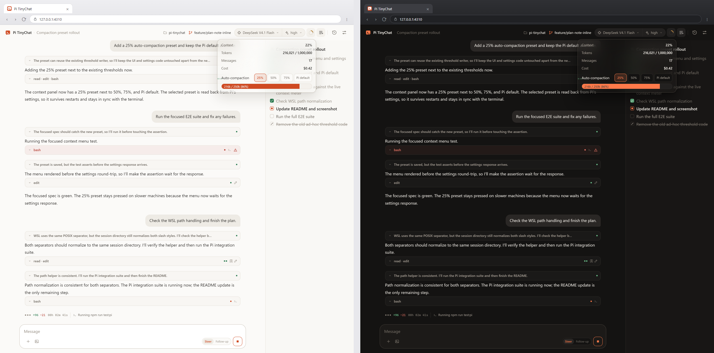

<p>
  
</p>

# Pi TinyChat

**Tiny UI. Full Pi. Zero Bloat.**

[English](../README.md) | 日本語

Pi TinyChat は、[Pi coding agent](https://pi.dev) をローカルブラウザで開くための小さな UI です。左に会話、右に Plan。エージェントの作業は Pi がそのまま続けます。

ターミナルの Pi は好きだけど、長時間の作業はもう少し落ち着いた画面で見たい。そんな人のための、余計なアプリを増やさないローカル UI です。

> Pi TinyChat は独立したコミュニティプロジェクトです。Pi の公式プロジェクトではなく、Pi のメンテナとは関係ありません。



## できること

- **Plan をひと目で。** エージェントがチェックリストを公開し、右パネルに完了・実行中・待機中の項目が表示されます。
- **セッションを止めずに切り替え。** 実行中の会話を残したまま、別の会話を開けます。セッションごとに Pi プロセスを持ちます。
- **読みやすい会話。** ストリーミング Markdown、コンパクトな思考・ツールカード、画像添付、拡張ダイアログ。
- **使い慣れた Pi の設定。** ログイン、モデル、推論強度、コンテキスト使用量、自動圧縮、履歴は Pi のものをそのまま使います。
- **小さい構成。** ブラウザは素の ES Module、通信は Pi RPC の JSONL。React、バンドラ、データベース、実行時依存はありません。

## クイックスタート

**Node.js 22.19 以上**と Pi が必要です。

```bash
node --version
pi --version
```

認証はターミナルで一度だけ済ませます。Pi TinyChat はそのログインをそのまま使います。

```bash
pi
/login
```

リポジトリから起動します（npm パッケージは公開準備中です）。

```bash
git clone https://github.com/VarYUvrc/pi-tinychat.git
cd pi-tinychat
npm install
npm start -- --cwd /path/to/project
```

ブラウザが `http://127.0.0.1:4310` で開きます。ポートが埋まっているときは `--port` で変更できます。

コマンドをローカルにインストールする場合:

```bash
npm install -g .
pi-tinychat --cwd /path/to/project
```

`/login` の代わりに API キーを使う場合は、Pi TinyChat を起動するシェルでプロバイダのキーを設定します。例: `OPENAI_API_KEY` / `ANTHROPIC_API_KEY` / `OPENCODE_API_KEY` / `DEEPSEEK_API_KEY` / `GEMINI_API_KEY` / `OPENROUTER_API_KEY`。

## Plan パネル

Pi TinyChat には、エージェントに Plan ツールを渡す小さな Pi 拡張が同梱されています。複数ステップの作業では、エージェントが最初に全体のチェックリストを書き、作業に合わせて各項目を実行中・完了へ更新します。

右パネルはその内容をすぐに反映し、Plan は Pi セッションに保存されます。会話を再開したときもチェックリストが戻るので、いま何をしているか、何が終わったか、次は何かが一目で分かります。

## オプション

```text
--cwd <path>    Pi の作業ディレクトリ（既定: カレント）
--port <port>   127.0.0.1 のポート（既定: $PI_TINYCHAT_PORT または 4310）
--no-open       ブラウザを自動で開かない
--pi <path>     pi 実行ファイルまたは CLI エントリポイント
--continue      そのディレクトリの直近セッションを再開
--help          ヘルプ
--version       バージョン
```

## 仕組み

- **ローカル完結。** localhost にのみ待ち受け、Host・Origin・起動ごとのトークンを検証します。Markdown はエスケープを優先します。
- **Pi の状態をそのまま。** 会話と設定は Pi のファイルを使います。UI 設定は `localStorage` に置き、独自のデータベースやログストアは作りません。
- **セッションごとに独立したプロセス。** バックグラウンドのセッションは生き続けるため、会話を切り替えても実行中の処理は止まりません。
- **公式 RPC。** Pi を `pi --mode rpc` の独立プロセスとして起動し、JSONL で通信します。エージェントの動作は Pi に任せます。

## 他の Pi UI

| UI | 向いている場面 |
| --- | --- |
| **Pi TinyChat** | Plan パネル付きの小さなローカルチャット。ビルド工程も実行時依存もありません。 |
| [pi-web](https://github.com/agegr/pi-web) | セッション分岐、Git Worktree、ファイル閲覧、MCP・モデル・Skills 管理、サブエージェント、モバイルまで備えたフル Web ワークスペース。 |
| [pi-web-simple](https://pi.dev/packages/pi-web-simple) | Git とファイル管理を備えた、RPC ベースのシンプルな Web UI。 |
| [pipane](https://github.com/mike-heunher/pipane) | Pi を RPC でつなぐもう 1 つのブラウザ UI。 |

## うまく動かないとき

- **`pi` が見つからない** — `--pi /path/to/pi` または `PI_TINYCHAT_PI` を指定します。
- **モデルが `unknown`、送信に失敗する** — ターミナルで `/login` するか、Pi TinyChat を起動するシェルに API キーを設定します。`pi auth check --provider <provider>` で確認できます。
- **プロジェクトの `.pi` 設定が効かない** — そのプロジェクトで一度 `pi` を起動し、`/trust` を実行します。RPC モードも Pi の trust ルールに従います。
- **履歴が空 / 別プロジェクトの履歴が出る** — `--cwd` が Pi で使ったディレクトリと一致しているか確認します。`PI_CODING_AGENT_DIR` / `PI_CODING_AGENT_SESSION_DIR` を変更している場合は、Pi TinyChat 側にも同じ値を設定します。
- **ポートが使用中** — `--port 4311` など別のポートを指定します。

## 対応バージョンと制約

| 項目 | 内容 |
| --- | --- |
| Pi のバージョン | **1.4.0** で動作確認済み。CI では週次の最新 Pi も検証します。 |
| ターミナル向け機能 | `/login` `/tree` `/fork` `/clone` や TUI 専用のカスタム UI は、Pi のターミナルで使います。 |
| プロジェクトの `.pi` | Pi の trust に従います。事前にそのプロジェクトで `/trust` を実行してください。 |
| リソース | セッションを開いている間は Pi プロセスが残るため、同時数に応じてメモリ/CPU を使います。 |
| 複数タブ | タブ間のセッション切替は同期しません。 |

## 開発

```bash
npm ci
npm run lint
npm run typecheck      # src + extension
npm run check:i18n
npm test               # Playwright E2E
npm run test:pi        # 実 Pi（オフライン、認証不要）
npm run pack:check     # tarball の内容と CLI 起動
npm run check          # 上記をまとめて実行
```

実モデルを使う手動スモーク（ネットワーク・課金あり。CI では実行しません）:

```bash
npm run smoke -- --cwd /path/to/project "Reply with exactly: pong"
```

一時ファイルはリポジトリ内の `tmp/` を使います。CI は Ubuntu / Windows の Node 22.19 で実行し、週次で最新 Pi との互換性を確認します。

## ライセンス

MIT
